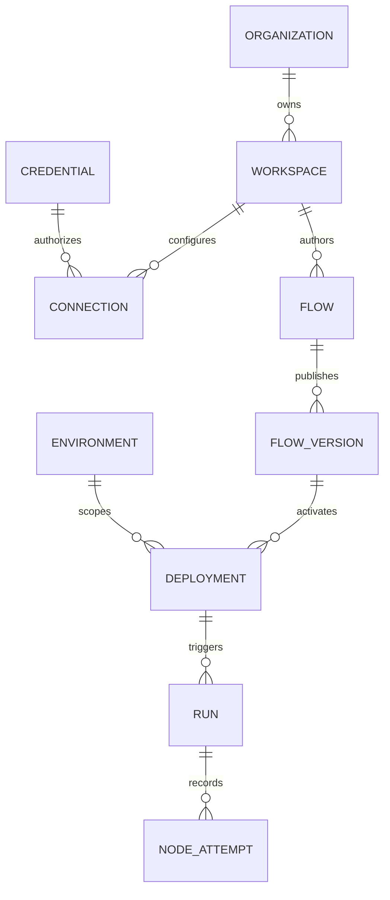

# Domain model and ownership

Status: **Proposed**. Use strong identifiers, explicit state machines and a
single owner for each transition. Avoid placing all models in `conctr-core`.

| Aggregate / value | Owner | Invariant |
| --- | --- | --- |
| IDs, correlation IDs, pagination primitives | core | Distinct resource IDs cannot be confused |
| Principal, membership, role grants and permission decision | auth | Resource scope is checked server-side |
| Flow draft, node/port/edge types, version and compiled plan | flow | A publishable graph validates independently of any UI |
| Connection/environment configuration and deployment intent | application | Bindings are scoped and activation is atomic |
| Credential metadata/reference and resolution capability | secrets | Reads never expose reusable secret material to UI |
| Run, node invocation, attempt, retry and lease states | engine | State updates obey current owner/fencing token |
| Connector descriptor, operation config and outcome | connectors | Declared versions/capabilities match execution behavior |
| Mapping AST and conversion/validation errors | transform | Evaluation is bounded and cannot perform arbitrary IO |
| SQL rows, migrations and blob-object records | storage | Persistence maps domain values; SQL types do not escape |
| Public request/response and event envelopes | contracts | Wire versions are deliberate and secrets excluded |

## Relationship sketch

These are conceptual relationships, not a complete SQL schema. A run also pins
version/binding IDs directly; deleting a deployment must not erase its evidence.
A connection references an environment-scoped credential and versioned endpoint
configuration. Cross-scope references are invalid even when their IDs exist.

## Authoring and deployment lifecycle

A draft is mutable and uses revision/ETag checks. Publishing validates semantics
and produces an immutable flow version. Activating creates a deployment revision
with connector versions, connection versions and authorized binding references.
Runs pin that revision. Editing a draft or connection cannot mutate in-flight
semantics. Rotation policy may resolve the newest permitted secret version at
attempt time; record the resolved version ID without recording the secret.

Disable stops future trigger admission; cancel is a separate request concerning
existing runs. Archive removes an item from normal authoring views but preserves
history under retention policy. Rollback activates a previous compatible artifact
for future runs. Deletion must respect references, retention and audit rules.

## Concurrency and errors

Optimistic authoring revisions prevent lost updates. Activation uses a transaction
and a scoped uniqueness rule for the active revision. Distinguish invalid input,
conflict, forbidden, missing, dependency unavailable, resource exhausted and
unknown external outcome. An error carries a safe code/message/correlation ID;
transport adapters map it to HTTP or server-function errors.

See [vocabulary](../product/glossary.md) for the visible product names.
