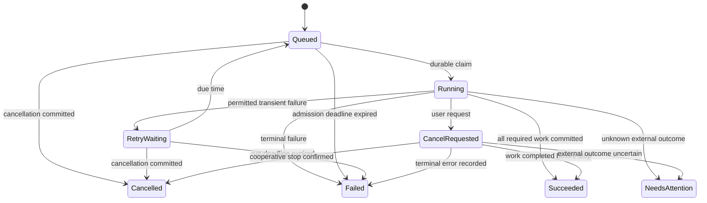
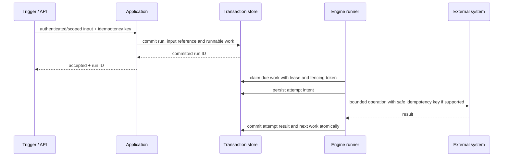

# Execution and recovery model

Status: **Proposed**. This is the reliability contract to implement and test;
the existing engine crate is still a scaffold.

## Run and attempt states

A run may contain many logical node invocations and many attempts per invocation.
Attempts record queued/start/end times, input/output references, operation version,
error classification and ownership token. Waiting-for-signal/human approval states
are deferred until durable resume, authentication and expiry are specified.

## Durable admission and execution

Acknowledge an asynchronous webhook or run request only after durable admission.
A queue hint is not the source of truth. If a separate broker is introduced,
commit a transactional outbox record with state changes, then deliver it with a
retrying dispatcher and deduplicating consumer. Outbox delivery is at least once.

## Delivery guarantee and ambiguous outcomes

Target **at-least-once durable work processing**, with explicit operation-level
idempotency. Do not claim exactly-once external effects. A process can fail after
an external POST succeeded but before its result was persisted. A new lease does
not reveal whether the POST happened. Lease fencing protects database state; it
cannot cancel or fence an external API that does not support it.

Classify outcomes as success, permanent failure, retryable failure or unknown.
For an unknown unsafe side effect, move to NeedsAttention unless an operation's
contract provides a safe reconciliation/idempotency mechanism. Record the intent,
request fingerprint and remote correlation reference without persisting secrets.

Deduplication keys must include organization/workspace, deployment/trigger scope
and external message key. Key acquisition and admission must be transactional;
track in-progress/completed/expired records, not a check-then-insert race. Keep
completed deduplication records for a defined replay window.

## Policies

| Concern | Proposed rule |
| --- | --- |
| Retries | Bounded attempts, exponential backoff with jitter, deadline ceiling; respect safe Retry-After within limits |
| Retry scope | Operation/node attempt, not blindly restarting the whole flow |
| Unsafe writes | Default to one attempt until a documented idempotency/reconciliation policy exists |
| Timeouts | Connection/request/node/run deadlines; explicitly distinguish remote timeout from confirmed rejection |
| Cancellation | Persist intent, stop admitting new work, signal cooperative IO cancellation; do not promise rollback |
| Leases | Durable owner, expiry and monotonic fencing token; renew and reject stale commits |
| Scheduling | Injected clock; persist due times, timezone, missed-fire and overlap policy; unique occurrence IDs |
| Ordering | No global ordering claim; preserve only the explicitly configured partition/sequence contract |
| Backpressure | Bound workers, per-tenant/connection concurrency, queue depth, payload sizes and node output count |
| Dead letter | Record terminal cause/disposition; replay is a separate authorized action |

Recover by reconciling expired leases against recorded attempt intent and effect
safety, not by assuming every running attempt never executed. Persist each logical
continuation and the next-work creation in the same transaction. Do not hold a
SQL transaction open during external IO. Test crash points before/after every
boundary in the sequence above.

## Replay and compensation

Replay creates a new linked run with an explicit version/binding selection and
input retention check. Default to the original immutable version; validate
current permission and secret resolution again. Warn about duplicate side
effects. Compensation is a later explicit business operation, not a generic
inverse of any connector call or a claim of distributed rollback.

Camel's [recovery strategies](https://camel.apache.org/manual/error-handler.html)
and [idempotent-consumer pattern](https://camel.apache.org/components/4.22.x/eips/idempotentConsumer-eip.html)
inform the vocabulary; these Conctr guarantees require their own implementation
and failure-injection tests.
