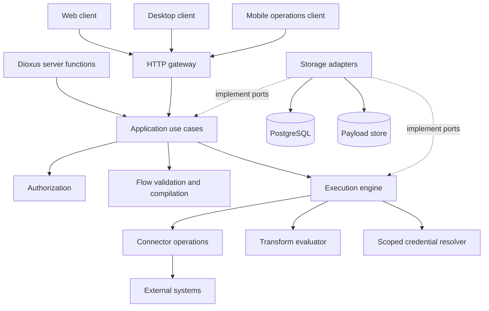

# System overview

Status: **Proposed target architecture**. Today only the component library and
showcase are substantial implementations. Other package names are boundaries
to develop, not already functioning services.

## First deployment

Start with a modular server process and PostgreSQL. Keep HTTP ingress, use cases,
runtime execution and persistence as separate modules/crates but wire them in
one composition root. Store large payloads through a blob-store port; development
may use a bounded local adapter, distributed workers require shared storage.
Do not introduce Kubernetes, Redis or a message broker as mandatory MVP services.

Arrows here show calls/data paths, not Cargo dependencies. The server composition
root constructs adapters and injects ports. In particular, the engine must not
import the SQL storage crate, and the UI library must not import app services.
The optional Dioxus server-function adapter uses the same authorization and use
cases as the generic HTTP API.

## Control plane and execution plane

The control plane owns authoring, connection metadata, versions, deployment
activation, authorization and audit queries. The execution plane claims durable
work, resolves authorized bindings, invokes operations and records attempts.
They may share a process initially; their separation is a responsibility boundary.

Later, extract `apps/conctr-worker` when isolation, reliability or measured load
requires a separate process. The existing server executable `conctr-api` is
currently under `crates/`; recommend moving its composition root to
`apps/conctr-api/` when real bootstrapping is implemented, keeping its package
name. That move and the worker app are not performed by this documentation work.

## Dependency direction

`core` is small and foundational. `flow`, `auth`, `transform`, connector contracts
and secret-resolution contracts build on it. `engine` owns runtime ports and uses
those contracts. `application` orchestrates use cases and owns administrative
repository/unit-of-work ports. `storage` implements owner-defined ports. Transport
adapters depend inward on use cases and public contracts. Executables are the
only composition roots that select concrete infrastructure.

Do not create an engine/application cycle: the application may dispatch through
an engine facade, but engine code must not import application services. Both
can use a persisted run request represented by engine-owned types.

## Scope assumptions for review

Self-hosted first; organization/workspace isolation designed from the start;
web/desktop share authoring; mobile prioritizes operations; HTTP JSON first;
long-running human approval, arbitrary code and multi-region execution deferred.
Review these assumptions in [open questions](../roadmap/open-questions.md).
